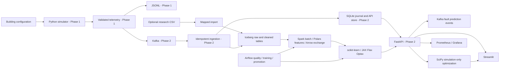

# BuildingPilot AI

Intelligent HVAC monitoring, fault detection, forecasting and optimization, built in ten
working phases. **All ten implementation phases are present. Simulator observations are synthetic and control is
simulation-only.** No field validation or measured savings are claimed.

## Run the complete local platform

```powershell
uv sync --locked
uv run python scripts/init_local.py
docker compose -f compose.yaml -f compose.lake.yaml -f compose.apps.yaml -f compose.monitoring.yaml up --build -d
# Export the running Kafka journal into the shared lakehouse:
docker compose -f compose.yaml -f compose.lake.yaml run --rm batch
# Spark aggregation and Iceberg maintenance:
docker compose -f compose.yaml -f compose.lake.yaml run --rm spark
# Explicit synthetic experiment, gated promotion and inference in a separate demo DB:
docker compose -f compose.yaml -f compose.apps.yaml run --rm demo
```

Build the Spark job image first with `docker compose -f compose.yaml -f compose.lake.yaml
build spark`. Airflow is an optional separate profile; see the operations guide. The Docker
services share the generated model artifacts; demo observations remain in a separate database.
Native commands for the same full lifecycle are available:

```powershell
uv run python -m buildingpilot.demo --days 12 --epochs 30
```

Native demo artifacts live under `data/demo`; Docker demo artifacts live in the operational
named volume. They are separate runs. See the serving commands in the operations guide.
All reported optimization effects are simulated, and no physical equipment is controlled.

| Interface | Address |
|---|---|
| FastAPI and interactive docs | http://localhost:8000/docs |
| Streamlit | http://localhost:8501 |
| Prometheus | http://localhost:9090 |
| Grafana | http://localhost:3000 |
| Airflow (optional profile) | http://localhost:8080 |
| Iceberg REST catalog | http://localhost:8181 |
| Object-store console | http://localhost:9001 |

All credentials are generated locally in ignored storage. No cloud resources are created.
API/consumer/SQLite are a local single-node design, and supervised training needs valid
normal/fault coverage. Live normal-only telemetry is not relabeled to manufacture faults.

Read the phase guides for decisions, data flow, tests and limitations:

- [Phase 3: Iceberg, Arrow, Polars, pandas and Spark](docs/phase3.md)
- [Phases 4-7: models, control, API and Streamlit](docs/ml-control.md)
- [Phases 8-10: lifecycle, monitoring, Helm and Nix](docs/operations.md)
- [Optional Azure deployment design](docs/azure.md)

## Architecture proposal

Open [architecture.html](architecture.html) in a browser for an offline interactive map:
runtime flow, Python imports, every code/configuration file with embedded source, and the
full phased roadmap. Planned components are labeled separately from the implemented system.
Refresh the snapshot after editing the repository:

```powershell
python scripts/build_architecture.py
```

Keep a typed domain core independent of Kafka, storage, APIs and orchestration. Start with
three single-zone buildings and JSONL output. Later adapters will carry the same versioned
contracts through Kafka and an Iceberg lakehouse. Train offline, evaluate chronologically,
and promote only candidates meeting explicit quality gates. Serve approved artifacts through
FastAPI and display results in Streamlit.



The diagram shows implemented components; optional deployment services need explicit startup. See
[architecture.md](architecture.md) for interfaces, library roles, lakehouse design and safety.

## Run Phase 1 (PowerShell)

Install Python 3.12 and uv, then:

```powershell
cd C:\Users\zubay\Desktop\HVAC\hvac-system
uv sync --locked
uv run buildingpilot --steps 288 --output data/day.jsonl
uv run pytest -q
uv run ruff check .
uv run ruff format --check .
uv run mypy
```

The simulation emits **864 JSON lines**: 288 five-minute intervals for each of office,
retail and school, beginning Monday 2026-01-05 00:00 UTC. The final JSON summary reports
`events: 864`, `buildings: 3`, `source: synthetic`. Each line contains schema/version,
event/building/equipment identifiers, UTC event time and the measurements described below.
The output is created exclusively: rerunning requires a new filename to protect prior data.

```powershell
uv run buildingpilot --steps 288 --fault-building office --missing-every 12 --output data/faults.jsonl
uv run buildingpilot --continuous --interval-seconds 5 --output data/live.jsonl
```

Continuous mode writes three events per interval and flushes after each group. Stop with
Ctrl+C. `--interval-seconds` changes simulated time and continuous pacing (1..900 seconds).
Finite mode runs without sleeping. Repeating the same seed, start and options reproduces
identical events. Missing indoor readings become JSON null without corrupting latent state.
Heating degradation delivers 45% of commanded heating at unchanged estimated electrical
input; labels indicate active injected heating faults, not inferred diagnoses.

## Repository structure

```text
hvac-system/
  pyproject.toml          package, CLI, Ruff, mypy and pytest configuration
  uv.lock                resolved development/build dependencies
  .python-version        Python 3.12
  src/buildingpilot/
    domain.py            immutable building/telemetry contracts and validation
    simulator.py         thermal model and baseline controller
    cli.py               iterator and JSONL/wall-clock adapter
    contracts.py         Pydantic validation at external boundaries
    api.py               HTTP contracts and serving
    broker.py            Kafka and explicit local publisher adapters
    ingestion.py         broker payload validation and quarantine handling
    storage.py           SQLite journal, registration and query adapter
    producer.py          simulator-to-Kafka entry point
    worker.py            separate ingestion consumer process
    settings.py          environment configuration
    logging_config.py    structured operational logging
  tests/test_phase1.py    unit, integration and subprocess CLI tests
  tests/test_phase2.py    API, persistence, replay and concurrency tests
  tests/test_kafka_integration.py   opt-in real broker verification
  compose.yaml           local Kafka/API/ingestion/simulator stack
  Dockerfile             non-root application image
  architecture.md        full target design and phased plan
  docs/thermal-model.md  equations, units and calibration limitations
  docs/phase2.md         Phase 2 contracts, decisions and recovery behavior
```

The domain uses standard-library dataclasses with runtime validation; Phase 2 uses Pydantic
at API and broker boundaries. FastAPI, Uvicorn and kafka-python provide serving and streaming.
Hatchling is
only the package build backend. uv isolates and locks tooling. Setup follows the
[official uv project guide](https://docs.astral.sh/uv/guides/projects/).

## Verification and limitations

Tests check the analytical thermal solution, cold-weather heat loss, fault effects,
building isolation, deterministic output, UTC/range validation, missing values, IDs,
month-long simulation and CLI execution. Run all four quality commands above.

This is a single-zone engineering simulator, not calibrated building physics. Humidity,
CO2 and supply temperature are bounded proxies. Weather is generated; schedules use a
fixed UTC offset without daylight-saving transitions. Energy is interval kWh, temperatures
are Celsius, demand is thermal kW, airflow is m3/s, and positions are percentages. Indoor
and return temperatures represent the start of the interval; consumption covers the interval.
The Phase 1 JSONL CLI has no restart/checkpoint database. The Phase 2 Kafka path uses a
durable SQLite ingestion journal and deduplication. Iceberg, ML, simulated optimization, dashboard, orchestration and deployment packaging
are now implemented; verification scope is documented below. See the architecture document for explicit phase gates.

## Run Phase 2

Start Docker Desktop in Linux containers mode, then from the repository root:

```powershell
uv sync --locked
docker compose up --build -d
docker compose ps
Invoke-RestMethod http://localhost:8000/health/ready
Invoke-RestMethod http://localhost:8000/ingestion/status
Invoke-RestMethod http://localhost:8000/buildings/office/telemetry/latest
```

Open [interactive API documentation](http://localhost:8000/docs). The simulator emits three
events every five seconds through Kafka; latest/history becomes available after ingestion.
Counts should increase. Services use named volumes separate from existing JSONL files.
`docker compose down` stops the stack and retains those volumes.

```powershell
uv run pytest -q
uv run ruff check .
uv run ruff format --check .
uv run mypy

# Real Kafka integration; creates/removes only its unique test topic.
docker compose up -d kafka topics
$env:BP_TEST_KAFKA = '1'
uv run pytest -q -m kafka
Remove-Item Env:BP_TEST_KAFKA
```

For API development without a broker, explicitly select local transport:

```powershell
$env:BP_TRANSPORT = 'local'
uv run uvicorn buildingpilot.api:app --host 127.0.0.1 --port 8000
```

Local mode writes HTTP telemetry directly to SQLite and reports `transport: local`.
See [the Phase 2 guide](docs/phase2.md) for HTTP contracts, native Kafka commands,
recovery semantics and architectural decisions. Phases 3-10 are documented in the guides below.
