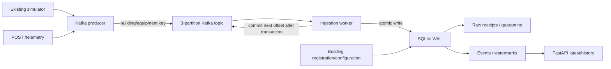

# Phase 2: HTTP serving and Kafka ingestion

Phase 1 generated inspectable files. Phase 2 separates production, buffering, validation,
persistence and query serving so processes can restart independently. No Phase 3 lakehouse
components are implemented. Existing simulator, domain and JSONL CLI remain unchanged.



## Architectural decisions

| Decision | Reason and trade-off |
|---|---|
| Preserve Phase 1 | Existing physics and reproducibility remain tested; producer reuses `generate()` |
| Pydantic at boundaries | Validates JSON types and inherited domain invariants; extra fields and nonfinite numbers rejected |
| Synchronous HTTP routes | FastAPI runs blocking broker/SQLite calls in its thread pool |
| Lifespan resource ownership | Initializes storage/publisher once and closes at shutdown; imports perform no network/database I/O |
| Separate producer and worker | API workers never run competing background consumer loops |
| Kafka key: building/equipment | Keeps a stream in one partition with a fixed partition count |
| Explicit three-partition topic | Predictable initialization, no accidental automatic topic creation |
| Acknowledged/idempotent producer | `acks=all` and idempotence protect transport retries; application resends still require event IDs |
| Per-record synchronous commits | Never acknowledges fetched but unprocessed records; lower throughput than batch commits |
| SQLite WAL operational store | Standard-library durable transactions without another database service; only suitable for a shared local disk |
| Atomic receipt/event/watermark | Commit ambiguity causes safe replay; no distributed exactly-once claim |
| Durable quarantine | Retains raw bytes/reason before advancing poison-record offsets |
| Event-time latest/history | Delayed arrivals cannot replace the latest event-time value |
| Explicit local fallback | API development without Docker, labeled local rather than Kafka delivery |
| Single-node KRaft broker | No ZooKeeper; low local overhead with no high availability |
| Named volumes / non-root app | Data survives container recreation; no writes into existing JSONL files |
| Loopback bindings | Local unauthenticated demo; production auth/TLS remains future work |

SQLite is an essential operational adapter, not an extra database service and not a
replacement for Iceberg. API/worker must share local disk; do not put WAL on network storage
or scale it across Kubernetes nodes. APIs do not depend on analytical libraries.

## API contract

| Method/path | Behavior |
|---|---|
| `GET /health/live` | Process liveness |
| `GET /health/ready` | Storage read and live broker metadata request; 503 if unavailable |
| `GET /buildings` | Persisted configurations; three demo buildings seed once |
| `POST /buildings` | Register full Building configuration; 201, duplicate ID 409 |
| `GET /buildings/{id}` | Configuration, unknown ID 404 |
| `PUT /buildings/{id}` | Replace configuration; equipment identity cannot change |
| `POST /telemetry` | Validate schema 1.0 and registration, publish; 202 after broker acknowledgment |
| `GET /buildings/{id}/telemetry/latest` | Latest by event time; no telemetry/unknown building 404 |
| `GET /buildings/{id}/telemetry` | History, ascending event time; start inclusive/end exclusive |
| `GET /ingestion/status` | Event, receipt, late counts and per-equipment maximum event times |
| `GET /docs`, `GET /openapi.json` | Interactive documentation and machine-readable contract |

History takes UTC `start`/`end`, `limit` (1..1000, default 100), and nonnegative `offset`.
Event IDs break timestamp ties. Late inserts can move offset-based pages; snapshot pagination
is not provided. Reading responses wrap `telemetry`, `received_at`, `is_late`, `out_of_order`.
Canonical units remain Celsius/kW/kWh/m3/s/ppm/percent. Only indoor temperature supports
explicit null. Configurable Fahrenheit/Wh conversion is future import work, not inferred.
Boundary identifiers are 1..128 ASCII letters/digits/dots/underscores/hyphens, starting
with a letter or digit, so registered IDs can be used reliably as URL path segments.

Invalid requests return 422, unknown building 404, conflicts 409, broker/storage failure 503.
`X-Request-ID` connects HTTP responses with structured logs without raw request bodies.
Broker timeouts can follow successful delivery: retry identical data with the same event ID.
`202` confirms broker acknowledgment, not immediate availability in history; poll for ingestion.
Local mode returns `transport: local`, `delivery: persisted` after writing directly to SQLite.
HTTP-invalid input is rejected before the journal; malformed Kafka input is quarantined.

Registration is checked again by ingestion for direct Kafka producers. Register first;
registration does not automatically retry quarantined data. Republish after correcting it.
The demo generator uses Phase 1's three archetypes; API configuration does not hot-reconfigure
it. Configuration history and multiple equipment per building are outside Phase 2. No dummy
ML endpoints are exposed before the corresponding models exist.

## Reliability semantics

The consumer disables auto-commit. Each receipt stores topic/partition/offset, raw bytes as
base64 (including malformed UTF-8), received_at, outcome and rejection reason. A unique
event ID identifies each validated event. Identical events at another offset are duplicates;
conflicting content under an accepted ID is quarantined. Replaying the same broker position
does not create another receipt. Do not recreate a topic with reset offsets while retaining
its old journal under the same topic name.

One transaction inserts receipt, event and stream maximum. Failure rolls everything back
and prevents offset commit. A crash between database and Kafka commits replays safely.
Commit/rebalance errors stop the worker; Compose restarts it. Storage failures never cause
records to be skipped. SIGINT/SIGTERM stop after the current record without acknowledging
unprocessed records. Restarting the simulator starts a new trajectory at current UTC unless
`--start` is specified; simulator state checkpointing is not implemented.

Out-of-order means timestamp before stream maximum. Late means earlier than maximum minus
`BP_ALLOWED_LATENESS_SECONDS` (default 900). Both are retained and queryable; the maximum
never decreases. Hourly recomputation is Phase 3 because no hourly analytical tables exist yet.

Deduplication state is indexed on disk, not an unbounded in-memory set. The durable journal
grows with input; retention/archival is still needed for sustained production use. Kafka
retention can expire unread input. API readiness does not prove consumer progress: inspect
worker logs and increasing event counts. Consumer lag metrics/alerts remain Phase 9.

## Run and expected results

With Docker Desktop in Linux containers mode:

```powershell
cd C:\Users\zubay\Desktop\HVAC\hvac-system
uv sync --locked
docker compose up --build -d
docker compose ps
Invoke-RestMethod http://localhost:8000/health/ready
Invoke-RestMethod http://localhost:8000/ingestion/status
Invoke-RestMethod http://localhost:8000/buildings/office/telemetry/latest
docker compose logs --tail 20 ingestion
```

Open http://localhost:8000/docs. Topic initialization exits 0 after idempotent creation.
The simulator generates three events every five seconds, with a five-second physical
timestep (time is not accelerated). Counts increase and readings report synthetic provenance.
Kafka is available at `127.0.0.1:9092` to native clients, `kafka:29092` to containers.
Explicit IPv4 avoids Windows localhost IPv6 resolution issues for the broker client.
`docker compose down` stops services and retains named volumes. The volumes are separate
from host `data/*.jsonl`; do not delete them casually for troubleshooting.

Native services using Compose Kafka, in separate terminals:

```powershell
docker compose up -d kafka topics
# Terminal 1
uv run uvicorn buildingpilot.api:app --host 127.0.0.1 --port 8000
# Terminal 2
uv run buildingpilot-ingest
# Terminal 3: one day, three buildings; replay reproduces IDs and deduplicates.
uv run buildingpilot-produce --steps 288 --start 2026-01-05T00:00:00Z
# Or continuous generation from current UTC:
uv run buildingpilot-produce --continuous --interval-seconds 5
```

Native services share `data/buildingpilot.db`; set `BP_DATABASE` to isolate a run. They read
process environment, not `.env` automatically. `.env.example` lists options. Compose sets
its bootstrap/database addresses and uses the default topic/group. Image tags pin uv/Kafka
versions; the Python base tag receives patch updates. Python packages are locked in uv.lock.

Broker-free development, terminal 1:

```powershell
$env:BP_TRANSPORT='local'
uv run uvicorn buildingpilot.api:app --host 127.0.0.1 --port 8000
```

Post a Phase 1 line from terminal 2 without modifying the source:

```powershell
$body = Get-Content data/my-first-day.jsonl -TotalCount 1
Invoke-RestMethod http://localhost:8000/telemetry -Method Post -ContentType application/json -Body $body
```

Remove `BP_TRANSPORT` before returning to Kafka mode. Optional `--fault-building office` and
`--missing-every 12` producer options retain the injected-label semantics of Phase 1.

## Verification

```powershell
uv run pytest -q
uv run ruff check .
uv run ruff format --check .
uv run mypy
docker compose config --quiet

docker compose up -d kafka topics
$env:BP_TEST_KAFKA='1'
uv run pytest -q -m kafka
Remove-Item Env:BP_TEST_KAFKA
```

Application tests cover Phase 1 regression, HTTP contracts/validation, durable reopening,
conflicting IDs, raw quarantine, late records, rollback and commit failures. The opt-in
Kafka test creates a unique topic, publishes through HTTP/producer, recreates its consumer
after persistence without offset commit, then checks replay, quarantine, committed offsets
and API latest readings. It removes only its own temporary topic. It is skipped by default;
enabling it without a reachable broker fails instead of substituting a mock.
The locked upstream Kafka and Starlette packages currently emit deprecation warnings
for resource-loading and HTTPX compatibility respectively; these warnings are visible,
not suppressed, and are not application test failures.

Verified during implementation: **46 tests passed with real Kafka enabled**, including all
23 Phase 1 tests. Ruff lint/format, strict mypy (16 source/test files), lockfile validation
and Compose configuration checks passed. The application image built, Kafka/API became
healthy, all three latest-telemetry endpoints returned synthetic records, and after restarting
the actual ingestion container the event count increased from 45 to 48 without data loss.
Counts are illustrative observations from this run, not fixed expected values.

Inspect quarantine using SQLite's Python support. For example, open
`uv run python` and execute:

```python
import sqlite3

connection = sqlite3.connect("data/buildingpilot.db")
print(
    connection.execute(
        "SELECT record_id, reason FROM receipts WHERE outcome = ?", ("rejected",)
    ).fetchall()
)
connection.close()
```

For Compose use `docker compose exec ingestion python` and `/app/data/buildingpilot.db`.
Raw bytes are in `receipts.raw_base64`; avoid copying them to shared logs.

## Official API references checked

- [FastAPI lifespan](https://fastapi.tiangolo.com/advanced/events/) and
  [lifespan testing](https://fastapi.tiangolo.com/advanced/testing-events/).
- [Pydantic dataclasses](https://docs.pydantic.dev/latest/concepts/dataclasses/) and
  [configuration](https://docs.pydantic.dev/latest/concepts/config/).
- [Kafka producer](https://kafka-python.readthedocs.io/en/3.0.0/apidoc/KafkaProducer.html)
  and [consumer](https://kafka-python.readthedocs.io/en/3.0.0/apidoc/KafkaConsumer.html).
- [Apache Kafka Docker](https://kafka.apache.org/41/getting-started/docker/) and
  [Docker Kafka guide](https://docs.docker.com/guides/kafka/).

No cloud resources, lakehouse tables, trained models or physical control are introduced.
